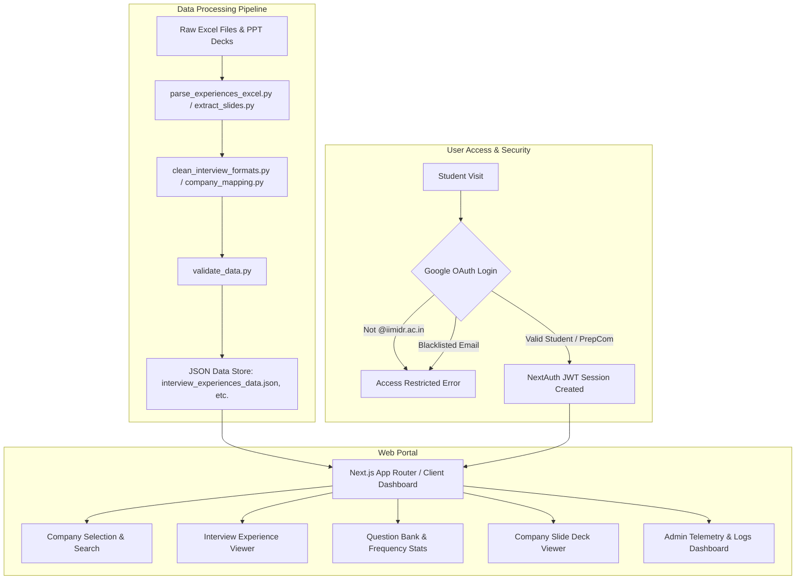

# 🎓 PrepChat

> **PrepChat** is an interview preparation intelligence platform designed specifically for students at **IIM Indore**. It aggregates, cleans, and structures years of real interview experiences, company interview formats, question frequency statistics, and corporate presentation slide decks into an interactive dashboard.

---

## 🌟 Key Features

- 🔐 **Institutional Authentication & Access Control**: Google OAuth restricted exclusively to `@iimidr.ac.in` domain accounts with server-side email whitelisting and blocklisting capabilities.
- 🏢 **Company-Wise Intelligence**: Deep insights into recruitment processes, interview rounds, focus topics, and question patterns for major hiring companies across finance, consulting, product management, marketing, and general management.
- ❓ **Prioritized Question Bank**: Categorized question frequency metrics allowing students to focus on high-yield interview questions.
- 📊 **Interview Formats & Schedules**: Structured breakdown of selection rounds (GD, WAT, Case Interviews, Technical, HR).
- 🖼️ **Company Presentation Slides Viewer**: Embedded slide deck extract viewer for company presentations and campus recruitment decks.
- 📈 **Telemetry & Admin Analytics**: Real-time user activity logging, daily active user tracking, query tracking, Excel report generation, and admin control panel (for PrepCom).
- ⚡ **Dual Deployment Options**: Modern full-stack Next.js 14 App Router application or standalone lightweight Python server.

---

## 🏗️ Architecture & Technology Stack

PrepChat is architected to support both a production serverless Next.js deployment and a standalone Python deployment.

### Core Stack

| Component | Technology | Description |
| :--- | :--- | :--- |
| **Frontend & Framework** | [Next.js 14](https://nextjs.org/) (App Router), React 18, TypeScript | Fast, server-rendered and client-interactive portal |
| **Styling** | Vanilla CSS3 / CSS Modules | Custom responsive design system with dark mode accents |
| **Authentication** | [NextAuth.js v4](https://next-auth.js.org/) | OAuth 2.0 via Google with hosted domain enforcement (`iimidr.ac.in`) |
| **Telemetry & Analytics** | `@vercel/analytics`, Vercel KV / JSON Persistence | Session & activity tracking, daily active users, query logs |
| **Standalone Backend** | Python 3 (`http.server`, RapidFuzz / Difflib) | Lightweight zero-dependency server alternative (`server.py`) |
| **Data Processing ETL** | Python 3 (pandas, openpyxl, python-pptx) | Automated scripts parsing Excel sheets, PPT decks, and raw markdown |

---

## 🔄 How It Works



### 1. Data Ingestion & Engineering Pipeline
Raw interview experiences, company formats, and slides are collected from senior students and placement decks. Python scripts process this data into fast, lightweight JSON payloads consumed directly by the web application:
- `parse_experiences_excel.py`: Converts raw Excel sheets into structured `interview_experiences_data.json`.
- `clean_interview_formats.py`: Cleans raw interview formats into `interview_formats_data.json`.
- `extract_slides.py`: Extracts slide text and structure from company `.pptx` decks into `slides_data.json`.
- `company_mapping.py` & `validate_data.py`: Normalizes company names across different datasets and verifies JSON integrity.

### 2. Authentication & Server-Side Security
Access is strictly protected to ensure internal placement information remains within IIM Indore:
- **Domain Gatekeeping**: NextAuth checks that Google OAuth accounts end with `@iimidr.ac.in`.
- **Dynamic Access Control**: `lib/accessControl.ts` validates incoming user emails against [access_control.json](file:///c:/Users/surya/Documents/PrepChat/access_control.json) for explicit whitelist or blocklist status before issuing a session token.
- **Role Assignment**: `prepcom@iimidr.ac.in` and authorized PrepCom members are granted `admin` privileges to access telemetry dashboards and control whitelists.

### 3. Telemetry & Analytics Logging
User interactions and searches are tracked via `/api/telemetry` (Next.js) and `/api/auth/track` (Python server):
- Records session durations, pages viewed, and queries made.
- Computes Daily Active Users (DAU) and tracks overall usage trends.
- Admins can export usage analytics as Excel reports or clear historic logs directly from the dashboard interface.

---

## 📂 Project Structure

```text
PrepChat/
├── app/                        # Next.js 14 App Router pages & API handlers
│   ├── api/                    # Serverless API routes
│   │   ├── auth/[...nextauth]/ # NextAuth authentication endpoint
│   │   ├── company/            # Company metadata routes
│   │   ├── experiences/        # Interview experience retrieval endpoints
│   │   └── telemetry/          # Activity tracking & admin telemetry handlers
│   ├── auth/                   # Custom Sign-In and Access Denied pages
│   ├── layout.tsx              # Root HTML & Providers layout
│   └── page.tsx                # Main Dashboard application component
├── lib/                        # Core server-side utilities
│   ├── accessControl.ts        # Whitelist/Blocklist verification logic
│   └── auth.ts                 # NextAuth options & security callbacks
├── frontend/                   # Standalone vanilla frontend assets
│   ├── index.html              # Standalone web UI
│   ├── app.js                  # Standalone client application logic
│   └── styles.css              # Standalone design system styles
├── Source Data files/          # Raw & cleaned markdown interview archives
│   ├── Final Interview Experience - 2013-2016.md
│   ├── Interview_Experiences_2013-2016_clean.md
│   └── Normalized_Interview_Formats.md
├── access_control.json         # Dynamic whitelist & blocklist configuration
├── company_industries.json     # Company to industry sector mapping
├── interview_experiences_data.json # Processed interview experiences dataset
├── interview_formats_data.json # Processed interview format dataset
├── questions_data.json         # Structured question bank dataset
├── slides_data.json            # Extracted PPT slide presentation data
├── server.py                   # Standalone Python backend server
├── parse_experiences_excel.py  # Python script to convert Excel to JSON
├── clean_interview_formats.py  # Python script to normalize interview formats
├── company_mapping.py          # Python script for company name normalization
├── validate_data.py            # Integrity validator for JSON datasets
├── .env.example                # Template for required environment variables
├── middleware.ts               # NextAuth authentication middleware
├── package.json                # Project dependencies & npm scripts
└── README.md                   # Project documentation
```

---

## 🚀 Getting Started

### Prerequisites

- **Node.js**: `v18.x` or higher
- **npm** or **yarn**
- **Python**: `3.9+` (optional for standalone server or data ETL scripts)

---

### Option A: Next.js Production App (Recommended)

1. **Install Dependencies**:
   ```bash
   npm install
   ```

2. **Configure Environment Variables**:
   Copy `.env.example` to `.env.local`:
   ```bash
   cp .env.example .env.local
   ```

   Fill in the required configuration:
   ```env
   # NextAuth Configuration
   NEXTAUTH_SECRET=your_generated_32_byte_secret_key
   NEXTAUTH_URL=http://localhost:3000

   # Google OAuth 2.0 Credentials (from Google Cloud Console)
   GOOGLE_CLIENT_ID=your_google_client_id.apps.googleusercontent.com
   GOOGLE_CLIENT_SECRET=your_google_client_secret
   HOSTED_DOMAIN=iimidr.ac.in
   ```

3. **Start the Development Server**:
   ```bash
   npm run dev
   ```
   Open [http://localhost:3000](http://localhost:3000) in your browser.

---

### Option B: Standalone Python Server

For lightweight local usage without Node.js dependencies:

1. **Install Python dependencies (optional for fuzzy search)**:
   ```bash
   pip install rapidfuzz
   ```
   *(Note: Falls back gracefully to standard library `difflib` if RapidFuzz is not installed).*

2. **Launch the server**:
   ```bash
   python server.py
   ```
   Open [http://localhost:8000](http://localhost:8000) in your browser.

---

## 📡 API Endpoints Reference

### Next.js API Routes (`/app/api`)

| Method | Endpoint | Description |
| :--- | :--- | :--- |
| `GET` / `POST` | `/api/auth/[...nextauth]` | Handles Google OAuth login, callbacks, and JWT session creation. |
| `GET` | `/api/experiences?company=<name>` | Retrieves structured interview experiences for a specified company. |
| `GET` | `/api/company` | Returns list of companies, categorized industries, and formats. |
| `POST` | `/api/telemetry` | Logs user page visits, search queries, and duration telemetry. |
| `GET` | `/api/telemetry?export=true` | Exports aggregated user activity report for admins (Excel / JSON). |

### Python Server Endpoints (`server.py`)

| Method | Endpoint | Description |
| :--- | :--- | :--- |
| `GET` | `/api/companies` | List all companies with metadata and industry categories. |
| `GET` | `/api/search?q=<query>` | RapidFuzz fuzzy search across questions, companies, and experiences. |
| `GET` | `/api/format?company=<name>` | Detailed interview format breakdown for the company. |
| `GET` | `/api/slides?company=<name>` | Slide content extracts from PPT presentations. |
| `POST` | `/api/auth/verify` | Authenticates and verifies student identity against whitelist. |
| `POST` | `/api/auth/track` | Tracks telemetry and active session data. |

---

## 🐍 Data Processing Pipeline Scripts

If new interview sheets or PPT decks are added, regenerate the datasets using:

```bash
# Parse Excel sheets into interview experiences JSON
python parse_experiences_excel.py

# Clean and normalize interview format data
python clean_interview_formats.py

# Map canonical company names across datasets
python company_mapping.py

# Validate JSON data integrity and report errors
python validate_data.py
```

---

## 🌐 Deployment on Vercel

PrepChat is ready for deployment on **Vercel**:

1. Push this repository to GitHub.
2. Import the project in the [Vercel Dashboard](https://vercel.com).
3. Set the following environment variables under **Settings ➔ Environment Variables**:
   - `NEXTAUTH_SECRET`
   - `NEXTAUTH_URL` (e.g. `https://your-domain.vercel.app`)
   - `GOOGLE_CLIENT_ID`
   - `GOOGLE_CLIENT_SECRET`
   - `HOSTED_DOMAIN` (`iimidr.ac.in`)
4. Click **Deploy**.

---

## 📋 Documentation Status

| Area | Status | Notes |
| :--- | :---: | :--- |
| **Project Overview & Readme** | 🟢 Complete | Comprehensive `README.md` covering architecture, setup, and both runtimes. |
| **Environment Configuration** | 🟢 Complete | `.env.example` provided with all NextAuth and Google OAuth variables. |
| **API Specifications** | 🟢 Complete | Next.js App Router and Python server endpoints documented in README. |
| **Data Pipelines & ETL** | 🟢 Complete | Python parsing scripts (`parse_experiences_excel.py`, etc.) documented. |
| **Access Control & Security** | 🟢 Complete | Whitelist, blacklist, domain gatekeeping, and admin role docs outlined. |
| **Frontend Documentation** | 🟢 Complete | UI layout, component hierarchy, and standalone HTML/JS documented. |

---

## 🔒 Security & Privacy Notice

- All interview data and placement materials belong to **IIM Indore**.
- Access is strictly restricted to `@iimidr.ac.in` email accounts.
- Unauthenticated requests or unauthorized domain accounts are blocked at edge level via NextAuth middleware and server callbacks.
